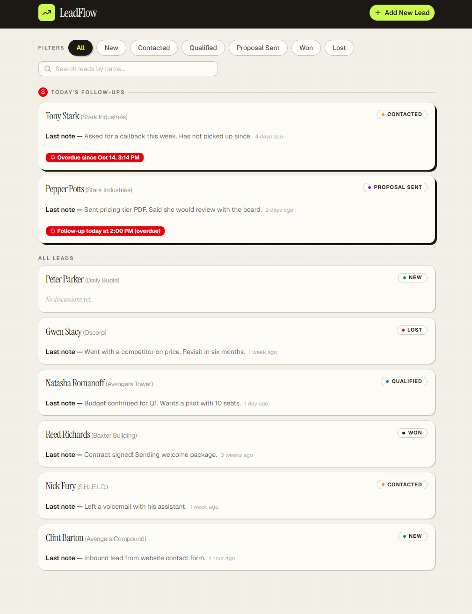
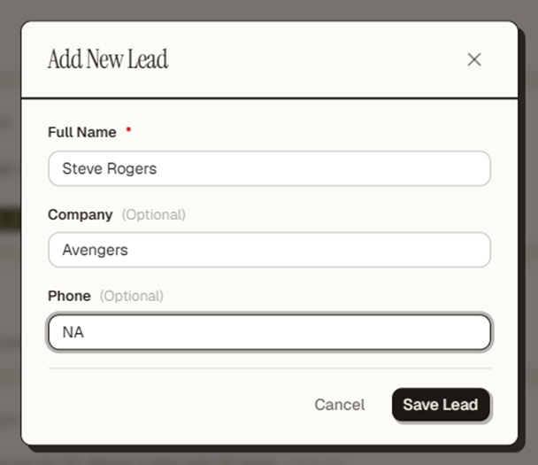
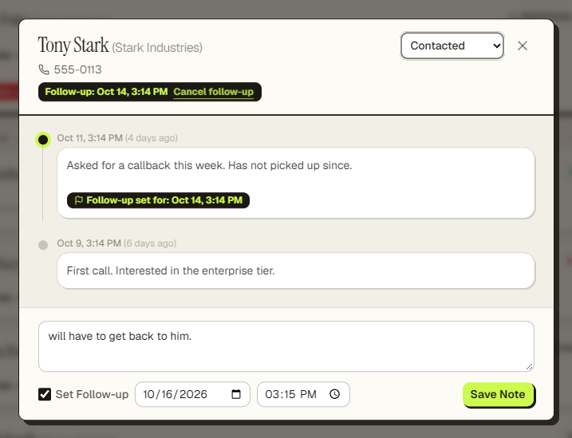

# LeadFlow

**The pipeline, on one screen.** LeadFlow is a lightweight CRM that keeps every
lead, every conversation, and every follow-up in a single place — so nothing
slips through the cracks.

No dashboards to configure. No leads to forget. Open it, work it, close the
day knowing exactly who to call next.



## Why sales reps keep it open

- **Today's calls, front and center.** Follow-ups due today or already overdue
  pin to the top of the board — overdue in red, sorted first.
- **Every conversation, in order.** Log discussions against a lead and watch
  the timeline build itself, newest first.
- **Follow-ups that move.** Set a reminder while you log a note, change it
  anytime, or cancel it in one click — history stays intact.
- **Find anyone in a keystroke.** Instant search and status filters combine.
- **Six clear stages.** New → Contacted → Qualified → Proposal Sent → Won or
  Lost.
- **It remembers.** Everything lives in SQLite, so it survives refresh,
  restart, and closing the laptop.

## Screenshots

| Add a lead | Work the details |
|---|---|
|  |  |

## Under the hood

- **Frontend** — Next.js 15 (App Router), TypeScript strict, Tailwind CSS v4,
  shadcn-style UI primitives (Base UI) with a custom editorial theme: warm
  paper, ink borders, hard shadows, Instrument Serif display type, and a
  volt-chartreuse accent. Dashboard at `http://localhost:3000`.
- **Backend** — FastAPI + Pydantic on stdlib `sqlite3` (no ORM). API at
  `http://localhost:8000`, all routes under `/api/v1`.
- **Database** — SQLite at `backend/data/leadflow.db`, created on first run.
  Override with `DATABASE_PATH`.

## Run it

Needs **Node 18+** and **Python 3.12+** (this repo was built with
[`uv`](https://docs.astral.sh/uv/), so every command below has a plain-`python`
equivalent).

```bash
# Backend — from backend/
cd backend
uv venv && uv pip install -r requirements.txt   # or: python -m venv .venv && pip install -r requirements.txt
uv run python seed.py                            # 8 demo leads
uv run uvicorn app.main:app --host 127.0.0.1 --port 8000

# Frontend — from frontend/, in a second terminal
cd frontend
npm install
npm run dev                                      # http://localhost:3000
```

Open `http://localhost:3000`. The dashboard reads `NEXT_PUBLIC_API_URL`
(defaults to `http://localhost:8000`; see [.env.example](./.env.example)).

## Configuration

| Variable | Default | Purpose |
|---|---|---|
| `DATABASE_PATH` | `backend/data/leadflow.db` | SQLite file (tests point it at temp files) |
| `CORS_ORIGINS` | `http://localhost:3000` | Comma-separated allowed origins |
| `NEXT_PUBLIC_API_URL` | `http://localhost:8000` | Frontend API base (baked in at build time) |

The database file and local `.env` are gitignored — they are dev data, never
committed.

## API

| Method & path | What it does |
|---|---|
| `GET /health` | `{ "status": "ok" }` |
| `GET /leads?status=&search=` | Lead list with `latest_note` / `latest_discussion_at` previews |
| `POST /leads` → 201 | `{ name*, company?, phone? }` — status starts `New` |
| `GET /leads/{id}` | Lead + discussions, newest first |
| `PATCH /leads/{id}` | `{ status?, name?, company?, phone? }` |
| `POST /leads/{id}/discussions` → 201 | `{ note*, follow_up_at? }` — writes the note and the follow-up in one transaction |
| `GET /leads/{id}/discussions` | Discussions, newest first |
| `DELETE /leads/{id}/follow-up` | Clears the current follow-up; history kept |

Timestamps are stored as UTC ISO 8601 and shown in the browser's local
timezone. "Today" means the same local calendar day; overdue means the
follow-up is in the past. A lead shown in the pinned section is not repeated in
the main list.

## Demo data

`backend/seed.py` loads 8 fictional Marvel leads covering every case —
a today follow-up (Pepper Potts), an overdue one (Tony Stark), a lead with a
full history (Natasha Romanoff), a fresh lead with none (Peter Parker), and
Won/Lost examples. Re-running is safe; existing names are skipped.

```bash
cd backend && uv run python seed.py
```

## Tests

```bash
# Backend — 30 pytest tests (isolated temp DB, fixed timestamps)
cd backend && uv run pytest -q

# Frontend — 31 Vitest component tests
cd frontend && npm test

# Typecheck, lint, production build
cd frontend && npm run typecheck && npm run lint && npm run build

# End-to-end — the full lead lifecycle through a real browser
# (requires the backend running; boots the production build itself)
cd frontend && npx playwright test
```

## Layout

```
backend/
  app/
    main.py          # app factory, CORS, /api/v1/health
    database.py      # sqlite3 layer: schema, parameterized queries, transactions
    schemas.py       # Pydantic models + validation
    routes/leads.py  # leads, discussions, follow-up endpoints
  seed.py            # demo data
  tests/test_api.py  # pytest suite
frontend/
  src/app/page.tsx          # dashboard: fetch once, filter client-side
  src/components/           # header, filters, cards, dialogs, timeline, forms
  src/components/ui/        # UI primitives (extend with `npx shadcn add …`)
  src/lib/api.ts            # typed HTTP client
  src/lib/date-utils.ts     # UTC parsing, local display, today/overdue logic
  e2e/lead-lifecycle.spec.ts
```

Reference mockups live in `provided-screenshots/`.
